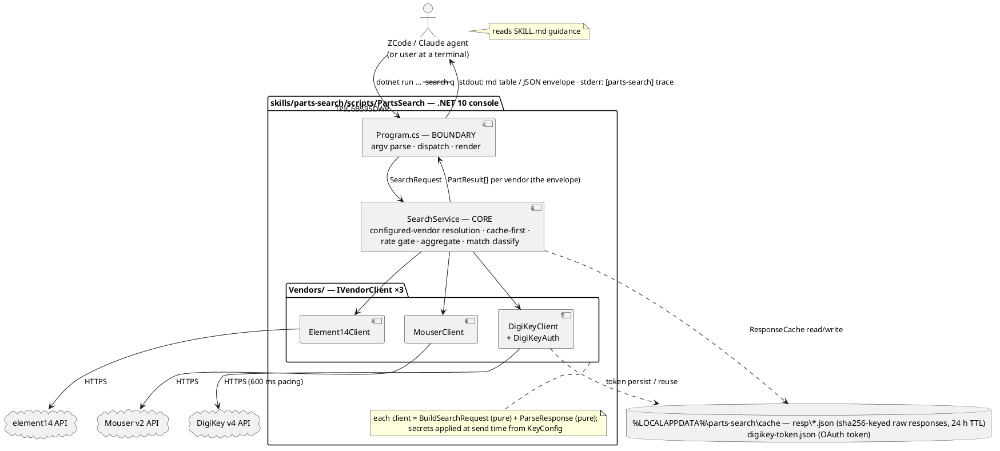

# Blueprint — Parts Search Tool

Current-state design of the parts-search plugin — a search-only electronic-parts CLI querying the official DigiKey, Mouser, and Newark (element14) APIs. Seeded from the `parts-search` production run (2026-10-24/25) and reconciled against the shipped source.

---

## 1. Requirements

**Problem this software solves.**
Coding agents (and the human behind them) researching electronic parts today fall back on generic web searches for availability and price: slow, unreliable behind JS-rendered storefronts, and unnormalized across distributors. This tool lets an agent run one CLI command that queries the official DigiKey, Mouser, and Newark (element14) APIs and returns structured stock/price data in a consistent shape. Scope was fixed with the user on 2026-10-23: a **search-only** skill — no BOM/CSV bulk mode (explicitly descoped by the user; see §4 and §12).

**Users and use cases.**
- **Coding agents** in ZCode/Claude sessions (primary user) — invoke the `parts-search` skill, which tells them when and how to call the CLI and how to read the output.
- **The plugin owner at a terminal** — runs the same CLI directly for a quick part check.

Typical queries: an exact MPN ("TPIC6B595DWR") priced at a build quantity; a Digi-Key part number ("HM1705-ND") or Newark order code ("83F8917") re-validated before ordering; a keyword hunt ("reverse mount green 1206 LED") when no MPN is known.

**Required capabilities (functional).**

- Search parts by MPN, distributor code, or free keywords, across any subset of {digikey, mouser, newark} in one invocation (`--vendor all` default).
- Return per-vendor **normalized results**: MPN, distributor part code, description, manufacturer, stock quantity, unit price at the requested quantity, full price breaks, lifecycle status, packaging (when the vendor provides it), vendor category (when the vendor provides it), product URL — each price with an explicit currency label, and the whole result set with an "as of" timestamp.
- Resolve **distributor-code queries** to the exact product through the same `search` command (no separate lookup mode).
- **Graceful degradation**: vendors whose API key is not configured are reported as `no_key`; a vendor error isolates to that vendor; neither ever fails the invocation.
- **One-time friendly setup**: `parts-search key set <vendor>` prompts (hidden input via echo-disabled line reads — pasted values register, nothing is displayed) and stores each API key in the Windows Credential Manager — the user never creates environment variables by hand; env vars remain the optional override/CI path. `key test` then verifies every configured key with one live limit-1 search per vendor (fixed probe query; cache write-through, never a cache read — so it always tests the *current* key), catching wrong-key-type silent failures at setup time.
- **Break-aware quantity hints**: when ordering a larger bracket quantity would cost less in total than the requested quantity, the affected result says so (`cheaper_at`), so agents can recommend the cheaper order quantity.
- **Find variants and alternatives**: `parts-search alternatives --q <mpn-or-text>` resolves the part (or best keyword hit), then surfaces same-base-MPN variants and same-category substitute candidates (cross-manufacturer included), each with an explainable `reason`.
- **Part details**: `parts-search details --vendor <v> --q <code-or-mpn>` returns one resolved part with its full **parameter table** and **datasheet links** — the data an agent needs to judge a substitute candidate.
- **Multi-part stock check**: `parts-search check --mpn <pn> --mpn <pn> [--qty N]` re-validates a shortlist of exact MPNs across vendors in one invocation — the per-line loop agents would otherwise run by hand.
- **Cache** vendor responses ~24 h to absorb repeated agent questions; `--no-cache` forces refresh.
- **Classify match confidence**: each result is marked `exact` (query equals the MPN or distributor code, case-insensitive) or `keyword`.
- Output in `--format json | table | md` (default `md` for agent consumption; `json` is the machine contract).
- Make a **fourth vendor** (e.g. LCSC) addable by implementing one client class and registering it — no other changes on the search path; the new vendor's key wiring (KeyConfig secret entries, env-var names, `key set`/`key clear` vendor tokens) is the stated exception (§5.1, §6.1), and so are adding its API host to `HttpSend`'s official-host allowlist and its arm in `HttpSend`'s 401/403 key-hint switch (G8, §8).

**Hard constraints (non-functional).**

- C# / .NET 10 console application (current LTS); JSON via `System.Text.Json`; **zero runtime NuGet dependencies** in the CLI project (the test project may use xunit, dev-time only).
- **Official vendor APIs only** — no scraping, no paid aggregators (Octopart declined).
- Free API tiers; requests sequential with a minimum interval of 600 ms between DigiKey HTTP calls (free tier ≈ 2 req/s); no parallel fan-out.
- API keys are never committed to any repo. Primary storage is the **Windows Credential Manager**, written by `parts-search key set` (generic credentials, DPAPI-protected per user; Win32 `CredReadW`/`CredWriteW`/`CredDeleteW` via P/Invoke keeps the zero-NuGet rule). Environment variables remain the override/CI path and win per secret when both are set: `MOUSER_API_KEY`, `DIGIKEY_CLIENT_ID`, `DIGIKEY_CLIENT_SECRET`, `ELEMENT14_API_KEY`.
- Cache and token state under `%LOCALAPPDATA%\parts-search\cache\` — nothing written inside any repo.
- Windows 10/11 x64; pure managed code, no native dependencies.
- The CLI source ships inside the plugin and runs via `dotnet run --project "${CLAUDE_PLUGIN_ROOT}/skills/parts-search/scripts/PartsSearch" -- …` (the established `visa` pattern; works from any working directory).
- House CLI conventions (as in `visa`): long-form flags `--name value` only (no `--flag=value`, no short flags); exactly one JSON object on stdout in `json` format; fixed exit-code table; human-readable stderr trace gated by `PARTS_SEARCH_LOG_LEVEL`.

**Existing systems and integrations.**
- **DigiKey Product Information v4** (`api.digikey.com`, KeywordSearch) — OAuth2 client-credentials token; the CLI hides the token dance.
- **Mouser Search API v2** (`api.mouser.com`) — single API key (the originating plan said v1; v1 is deprecated and v2 uses the same key).
- **element14 catalogue API** (`api.element14.com`) — single key; Newark is the US arm of element14.
- **This marketplace** (`plugin-marketplace/.claude-plugin/marketplace.json`) — the plugin registers here next to `visa`, `micro-cap`, `benchd`, `vref-kb`.
- The **RfSwitch** project (`../../RfSwitch` relative to this repo's root — a sibling workspace folder; its `docs/bom.md` holds hand-researched Digi-Key/Newark codes worth re-validating), but the tool is project-agnostic.

## 2. Context

The plugin lives in the owner's private marketplace repository; the sibling plugins share the plugin shape (`.claude-plugin/plugin.json`, `README.md`, `skills/<name>/SKILL.md`), with `docs/` common but not universal (`micro-cap` ships none), and the two plugins that ship .NET CLI source (`visa` and `vref-kb`) establish the invocation pattern: skill text + `dotnet run` against source shipped at `skills/<name>/scripts/<Project>`, .NET SDK on PATH as a stated prerequisite (`visa` states .NET 8; this plugin states .NET 10, the current LTS); `micro-cap` is the counter-example — a PowerShell wrapper around the installed `mc12_64.exe`, no shipped source. The originating design document is `../../Resources/Parts-Lookup-Tool-Plan.md` (relative to this repo's root — a sibling workspace folder; input context for this blueprint; its vendor research and decisions carry over — official APIs, C# CLI + skill over MCP server, env-var key overrides). The user descoped its BOM/CSV mode during drafting of this blueprint.

## 3. Goals

- **G1 — One-command search.** `parts-search search --q <query>` returns normalized results from every configured vendor among digikey/mouser/newark in a single invocation. Verified by unit tests with fake clients and by the opt-in live test.
- **G2 — Distributor codes resolve.** A Digi-Key part number (e.g. `HM1705-ND`) resolves via keyword search; a Newark/element14 order code (e.g. `83F8917`) resolves through the same field search (`term=any:`), the returned SKU confirming the exact product. Verified by request-build unit tests + live test.
- **G3 — Graceful degradation.** An invocation with zero, one, or three keys configured always exits 0 with a complete envelope; unconfigured vendors appear as `status:"no_key"`, a vendor failure as `status:"error"` with message — and every configured vendor failing is still exit 0 with the envelope: no per-vendor outcome ever changes the exit code or the stdout shape. Verified by unit tests.
- **G4 — Pricing correctness.** Unit price at quantity is derived from the vendor's monotonic price breaks (largest break whose threshold ≤ qty), every price carries a currency, and the envelope carries an `as_of` time. When a **larger bracket lowers the total cost** at the requested quantity, the part carries a `cheaper_at` hint — the smallest such bracket as qty/unit-price/total/savings; `null` otherwise. **Money-path: must-have executable tests.**
- **G5 — Lifecycle visibility.** NRND/EOL/obsolete signals map to a common enum (`active|nrnd|eol|obsolete|unknown`) per vendor. Verified by fixture-driven parser tests.
- **G6 — Cache.** Vendor raw responses cached 24 h keyed by vendor, request kind, query, limit, and market (qty excluded — price-at-qty is computed client-side); `--no-cache` bypasses; DigiKey's OAuth token cached until near-expiry. Verified by unit tests with a fake clock.
- **G7 — Skill and marketplace integration.** `SKILL.md` in the house style (when to use, prerequisites incl. one-time `key set` setup, invocation form, examples, output reading, as-of caveat, alternatives-finding guidance), plugin manifest, and a `parts-search` entry in `marketplace.json`; invocable from any cwd via `${CLAUDE_PLUGIN_ROOT}`. Verified by a smoke run from a different directory.
- **G8 — Vendor extensibility.** Adding a vendor = one `IVendorClient` implementation + one registration line, and no other changes on the search path; the exceptions are the new vendor's key wiring — KeyConfig secret entries, env-var names, and `key set`/`key clear` vendor tokens (§5.1, §6.1) — which a key-bearing vendor necessarily extends, one line in `HttpSend`'s official-host allowlist (§8's fixed-hosts rule), and an arm in `HttpSend`'s 401/403 key-hint switch (so the error names the new vendor's env var, not element14's). Verified by a test fake implementing the interface.
- **G9 — Safe, friendly key storage.** `key set/list/test/clear` manage and verify vendor secrets: storage in the Windows Credential Manager via P/Invoke (zero NuGet); env vars override per secret; `key list` prints presence and resolved source per secret (env / credential manager / none), never values; `key set` prompts read hidden console input (echo-disabled line reads — pasted values register in any terminal, the terminal displays nothing); `key test` probes every vendor with a live limit-1 search on the fixed probe query `resistor` (cache write-through, never a cache read — it verifies the *current* key): configured vendors report `pass | empty (suspect key type) | rejected | error`, unconfigured report `no_key`. Verified by unit tests against a fake `ICredentialStore` and fake console, plus the §10.1 redaction tests.
- **G10 — Variants and alternatives.** `parts-search alternatives --q <mpn-or-text>` reuses the search flow per configured vendor: exact hit plus same-base-MPN **variants** — and any same-category **alternatives** — from stage 1, then one description-based second search surfacing further **alternatives** (cross-manufacturer included) — every part carrying `relation` + `reason`. No new vendor endpoints (§6.4). Verified by unit tests on the pure classifier (pivot, stem rule, category rule, overlap fallback, ranking) and the live test's alternatives leg.
- **G11 — Part details.** `parts-search details --vendor <v> --q <code-or-mpn>` resolves one part (pivot rule: first exact match, else top result) through the search path, then expands it via the vendor's details endpoint (DigiKey ProductDetails, Mouser part-number search, element14 `id:` lookup): the full `PartResult` plus `parameters` and `datasheets`. Verified by request-build and fixture-parse tests per vendor.
- **G12 — Batch check.** `parts-search check --mpn <p1> --mpn <p2> …` runs one exact-match search per MPN per configured vendor (sequential, cached, paced), one envelope line per MPN with exact matches only. Verified by unit tests with fake clients (per-line degradation, pacing across DigiKey calls, repeatable `--mpn` parsing).

## 4. Non-goals

- **BOM/CSV bulk mode** — descoped by the user on 2026-10-23 ("we are not building a BOM"). No KiCad CSV parsing anywhere in v1; the per-line lookups themselves are v1 via the `check` command (G12) — the CSV extraction/orchestration is what stays deferred (§12).
- **LCSC or any fourth vendor in v1** — the architecture accommodates it (G8); it is not built.
- **Octopart or other aggregators** — paid; declined in the plan.
- **Parametric equivalence verification** — proving a candidate is a spec-level drop-in replacement, and merging category taxonomies across vendors, needs per-vendor parameter schemas and is the aggregators' moat. v1 ships the `alternatives` command (G10): explainable variants and same-category candidates that the agent then judges on the returned data; the ranked/parametric engine stays deferred (§12).
- **Scraping vendor websites** — ToS and Cloudflare/JS-rendering make it worthless; official APIs only.
- **MCP server** — declined in the plan; CLI + skill matches the user's existing patterns.
- **Ordering, carts, quotes, stock alerts, price-history tracking** — read-only lookup only.
- **`--market`/currency flag** — v1 fixes one market for all vendors, decided with the user on 2026-10-23: **Canadian market, CAD prices everywhere** (DigiKey site `CA`; Mouser `currencyCode=CAD`; element14 store `canada.newark.com`); no per-invocation market selection.
- **GUI, non-Windows testing, CI pipeline** — Windows 10/11 local tool; verification is local `dotnet test` (see §10.3).

## 5. Architecture



The boundary (`Program`, plus the boundary-side `KeyCommands`) is thin: parsing, dispatch, rendering, exit codes — no business logic. Everything with a branch or a rule lives in the core: vendor configuration resolution, cache policy, pacing, result normalization, match classification, price computation. All core components are pure or injectable-clock/injectable-HTTP and run host-free in unit tests; only the boundary pieces (`Program`, `KeyCommands`), the clients' `SendAsync`, and the `Win32CredentialStore` P/Invoke touch the machine — the latter two behind the interfaces the tests fake.

### 5.1 Component responsibilities

**Program (boundary)** — CLI entrypoint.
- Owns: argv parsing into a `SearchRequest`, `AlternativesRequest`, `DetailsRequest`, or `CheckRequest` — or a `key` subcommand — usage errors (exit 2), invoking `SearchService` (search/alternatives/details/check) or `KeyCommands` (key), rendering the envelope (`md`/`table`/`json`), exit-code selection, top-level exception → exit 4.
- Does not own: any policy — what vendors exist, caching, pricing, classification.

**SearchService (core orchestrator)** — public entries: `SearchAsync(SearchRequest) -> Envelope`, `AlternativesAsync` (two-stage), `DetailsAsync` (resolve-then-expand), and `CheckAsync` (per-MPN loop over the search path) — all sharing the registry, cache, pacing, and degradation.
- Owns: the vendor registry — the ordered list of `IVendorClient` implementations consulted per invocation; a fourth vendor is added by implementing the interface and appending one line to this list (G8); resolving which vendors are configured (`KeyConfig`), cache-first flow per vendor (`ResponseCache`), pacing DigiKey calls (`RateLimiter`), sequencing vendors (await one at a time), isolating vendor exceptions into `status:"error"`, aggregating into the result envelope (the §6.2 stdout JSON object), computing `match` classification, computing `as_of`, and driving the two-stage `alternatives` flow (stage 2: one description-based query per configured vendor through the same cache and `RateLimiter`).
- Does not own: HTTP specifics or response parsing (clients), key reading (`KeyConfig`), rendering.

**IVendorClient / DigiKeyClient / MouserClient / Element14Client (core)** — one class per vendor, shared interface.
- Each client exposes: `VendorId`, `IsConfigured(KeyConfig)`, `BuildSearchRequest(query, limit)` (pure — returns URL, headers-minus-secrets, body), `ApplySecrets(request, KeyConfig)` (the secrets-at-send step: stamps the built request with the vendor's key — and, for DigiKey, its token per §5.2 step 4 — immediately before sending; it is the one impure member, so a fourth-vendor author implements it alongside the pure pair), `ParseResponse(rawJson, query)` (pure — raw vendor JSON → `PartResult[]`), and the details pair `BuildDetailsRequest(vendorCode)` / `ParseDetailsResponse(rawJson)` (pure — one expanded product → `PartResult` + `parameters` + `datasheets`), same pure-build + apply-secrets-at-send rule.
- `DigiKeyClient` additionally collaborates with **DigiKeyAuth** (token acquisition + cached-token reuse) and routes distributor-code queries natively (Digi-Key part numbers work as keywords).
- `Element14Client` sends every search-path query — keyword, MPN, or order code — through the same field search (`details` uses the exact-field `term=id:` form, §6.4); exactness of an order-code query is decided by match classification (SKU equals query ⇒ `exact`) (G2).
- Does not own: caching, sequencing, envelope shape.

**AlternativesFinder (core, pure)** — the classifier behind the `alternatives` command (G10).
- Owns: pivot selection per vendor (first exact match, else top keyword result), the conservative base-MPN **variant** rule and category / description-overlap **alternative** rules (exact contracts in §6.2), formulaic `reason` strings, and ranking (same manufacturer first, then stock descending, then vendor relevance order).
- Input: one vendor's stage-1 and stage-2 `PartResult[]`; output: `relation` + `reason` per part. Pure over constructed results — runs host-free in unit tests.

**DigiKeyAuth (core)** — OAuth2 client-credentials flow.
- Owns: token request construction, cached token with `expires_at`, refresh when within 60 s of expiry, persistence of the token file.
- Does not own: the search calls themselves.

**KeyConfig (core)** — resolves the four secrets once at startup (digikey client id + client secret, mouser api key, newark api key — the optional DigiKey subscription key was removed per §6.4's fixture-decides rule): environment variable first, then the Credential Manager entry via `ICredentialStore`. Exposes `IsConfigured(vendor)` and secret getters. Never renders or logs secret values.

**CredentialStore / KeyCommands** — the secret-persistence pair behind G9.
- `ICredentialStore` is a pure interface; `Win32CredentialStore` implements it by P/Invoking `CredReadW`/`CredWriteW`/`CredDeleteW` for generic credentials under the target prefix `parts-search/<vendor>/<field>` (fields: `api-key` for mouser/newark; `client-id`, `client-secret` for digikey).
- `KeyCommands` implements `key set/list/test/clear` on top of the store and `KeyConfig`: hidden console input via echo-disabled line reads (disable `ENABLE_ECHO_INPUT` on the console input handle around `Console.ReadLine` — hidden AND paste-friendly, unlike a `ReadKey` loop which drops pasted input; the program itself never writes a secret; refuses with a usage error when stdin is not interactive), presence-and-source listing (`env` / `credential manager` / none per secret — values never formatted), a warning on `set` when an existing env var will shadow the stored secret, `test` (live limit-1 probe with the fixed query `resistor` — cache write-through, no cache read; configured vendors report `pass | empty (suspect key type) | rejected | error`, unconfigured `no_key`), clear scoped to the `parts-search/` target prefix only.
- No secret value ever reaches stdout, stderr, or a file.

**ResponseCache (core)** — file-backed raw-response cache.
- Owns: key derivation (`sha256(vendor|kind|query-trimmed-lowercased|limit|market)` — qty deliberately excluded), TTL check against an injected `IClock`, atomic writes (temp file + `File.Move` replace), startup pruning of entries older than 7 days.
- Does not own: deciding when to bypass (`--no-cache` is SearchService's input).

**RateLimiter (core)** — a per-vendor stopwatch gate: before each DigiKey HTTP send, wait out the remainder of a 600 ms window; other vendors pass through. Single-threaded by design; no locks.

**Render (core, pure)** — envelope → markdown table / aligned plain-text table / canonical JSON. Identical column semantics across `md` and `table`.

### 5.2 Data flow (happy path)

1. Agent invokes `parts-search search --q "TPIC6B595DWR" --qty 10` (skill supplies the `dotnet run` prefix).
2. `Program` parses argv → `SearchRequest { q, vendor=all, qty=10, limit=10, format=md, noCache=false }`; usage errors exit 2 here.
3. `SearchService` asks `KeyConfig` which of the requested vendors are configured; every unconfigured vendor short-circuits to a `no_key` outcome.
4. For each configured vendor, in fixed order (digikey, mouser, newark): derive the cache key, check `ResponseCache` — hit and fresh ⇒ reuse the raw response (no HTTP); miss or stale ⇒ `BuildSearchRequest`, apply secrets (acquiring a DigiKey token if needed — the token POST passes its own pacing gate), then pass the `RateLimiter` gate (DigiKey only) and send, storing the raw response in the cache. `--no-cache` takes the fetch path but skips **both** the cache read and the cache write (§6.1).
5. Each raw response goes through the vendor's `ParseResponse` → `PartResult[]`; a parse or HTTP failure becomes that vendor's `error` outcome and the loop continues.
6. `SearchService` computes `match` per result (exact ⇔ case-insensitive equality with MPN or distributor code), attaches qty-specific pricing (largest break ≤ qty), aggregates the envelope with `as_of`.
7. `Render` produces the md table (default) to stdout; the trace lines (cache hit/miss, HTTP status, ms, counts) went to stderr along the way; exit 0.

**Alternatives command flow** (`alternatives --q X`; steps 1–5 above run unchanged as stage 1, then per configured vendor):

1. `AlternativesFinder` picks the pivot (first exact match, else top result) and classifies stage-1 results by the §6.2 relation rules against it (`exact` / `variant` / `alternative` — classification is uniform across stages).
2. `SearchService` runs one stage-2 search per configured vendor — query = the pivot's manufacturer + the first six whitespace-separated tokens of its description, lowercased and single-space-joined (MPN excluded, so stage 2 hunts outside the family; the deterministic build keeps the §7.2 cache key stable) — through the same cache and pacing.
3. `AlternativesFinder` classifies stage-2 results per the §6.2 rules (`alternative` when same category + different base MPN; other stage-2 results follow the variant/exact rules or are dropped) and deduplicates against stage 1 by `vendor_part_number`.
4. Aggregation and rendering proceed as steps 6–7 above, with `relation`/`reason` on every part.

**Details command flow** (`details --vendor v --q X`; G11):
1. Steps 1–5 of the happy path run for vendor `v` only; the pivot (first exact match, else top result) is the resolved part — `no_results` ends the vendor outcome here.
2. `SearchService` calls `BuildDetailsRequest(resolved vendor_part_number)` through the cache (`kind:"details"`) and the pacing gate, then `ParseDetailsResponse`.
3. The envelope carries the single expanded part (`parameters`, `datasheets`); rendering per §6.3.

**Check command flow** (`check --mpn p1 --mpn p2 …`; G12):
1. For each MPN in flag order, the search path (steps 1–6) runs across the requested vendors — strictly sequential, cached, DigiKey pacing applying **across** lines.
2. Each line keeps **exact matches only** (`match:"exact"`); a vendor that searched but found no exact match reports `status:"ok"` with `parts: []`.
3. One envelope, one line per MPN (§6.2); exit 0 whatever the per-line outcomes (G3).

### 5.3 Threading / concurrency model

Single-threaded asynchronous flow: `Program.Main` awaits `SearchService.SearchAsync`, which awaits vendors strictly one at a time. No `Task.WhenAll`, no locks, no background workers — pacing and free-tier friendliness fall out of the sequencing. Cancellation is the console default (Ctrl+C terminates the process); no partial envelope is ever printed, and cache writes are atomic renames, so an interrupted run leaves at worst a stale entry that TTL-pruning later discards. Cache and token files are written only by this one process at a time in normal use; atomic replace makes concurrent agents racing on the same key harmless (last writer wins with equivalent content).

## 6. Wire contract

### 6.1 CLI surface

Four command families in v1 — `search` (the product), `alternatives` (variants + substitute candidates, G10), `details` (parameters + datasheets, G11), `check` (multi-MPN re-validation, G12), plus `key` (setup + verification, G9):

```
parts-search search --q <text> [--vendor all|digikey|mouser|newark] [--qty N] [--limit N] [--format json|table|md] [--no-cache]

parts-search alternatives --q <text> [--vendor all|digikey|mouser|newark] [--qty N] [--limit N] [--format json|table|md] [--no-cache]

parts-search details --vendor <digikey|mouser|newark> --q <code-or-mpn> [--qty N] [--format json|table|md] [--no-cache]

parts-search check --mpn <pn> [--mpn <pn> …] [--qty N] [--vendor all|digikey|mouser|newark] [--format json|table|md] [--no-cache]

parts-search key set <digikey|mouser|newark>    # prompts per required secret (hidden input) → Credential Manager
parts-search key list                           # per-vendor/per-secret configured state + source — never values
parts-search key test                           # live probe per vendor — pass/empty/rejected/error; no_key when unconfigured
parts-search key clear <digikey|mouser|newark>  # removes this tool's parts-search/* Credential Manager entries
```

| Flag | Type / domain | Default | Notes |
|---|---|---|---|
| `--q` | string, non-empty | required | MPN, distributor code, or keywords |
| `--vendor` | `all\|digikey\|mouser\|newark` | `all` | comma-lists (e.g. `digikey,mouser`) also accepted; `details` requires exactly one — no `all` |
| `--qty` | integer 1–100000 | `1` | quantity for unit-price computation |
| `--limit` | integer 1–50 | `10` | max results kept per vendor |
| `--format` | `json\|table\|md` | `md` | `json` is the machine contract |
| `--no-cache` | flag | off | bypass read and write of the response cache |

Unknown flags, missing `--q` (or `--mpn` on `check`), a missing or `all` `--vendor` on `details`, an unknown `key` subcommand or vendor token, out-of-domain values ⇒ usage error: the JSON error object (§6.2) to **stdout** regardless of `--format`, exit 2. Errors are always JSON so agents can parse failures uniformly. (The flag table above is `search`-scoped; each command's semantics below specializes it.)

`key` semantics: `key set digikey` prompts for client id and client secret; `key set mouser` / `key set newark` prompt for the single API key. The `key` commands print the same house-style single JSON object (`ok`, `command:"key"`, `sub`, plus what was stored/listed/tested/cleared) and follow the §6.2 exit codes, with these pinned shapes: `key set` → `{ "ok": true, "command": "key", "sub": "set", "vendor": "mouser", "stored": ["api-key"] }` (secret field names only, never values); `key list` → `{ …, "sub": "list", "vendors": { "digikey": { "client-id": { "source": "env" }, "client-secret": { "source": "credential manager" } }, … } }` with `source` ∈ `env | credential manager | none`; `key test` → `{ …, "sub": "test", "vendors": { "digikey": "pass", "mouser": "empty (suspect key type)", "newark": "no_key" } }` with per-vendor status ∈ the G9 vocabulary (`pass | empty (suspect key type) | rejected | error | no_key`); `key clear` → `{ …, "sub": "clear", "vendor": "newark", "cleared": ["api-key"] }`. They write secrets only to Credential Manager entries under the `parts-search/` target prefix — never environment variables, never secret files (`key test`'s documented response-cache write-through, §5.1, is the one file side effect) — and environment variables still override stored values per secret when both are set (§8). To keep that precedence visible, `key list` reports each secret's resolved source (`env` / `credential manager` / none) and `key set` prints a note when an existing env var will shadow the secret just stored.

`alternatives` semantics: same flags as `search` (`--qty` prices the parts; `--limit` caps the **alternatives** list — exact match and variants are always included, vendors return few — the stage-1/stage-2 fetches always use the default limit so a small `--limit` cannot fetch past an exact match ranked below the top relevance hit; `--limit` caps only the post-ranking alternatives list) and the same envelope/exit-code contract. It runs **two searches per configured vendor** (stage 1 as typed, stage 2 description-based); DigiKey pacing and the response cache apply to both stages, and distinct query strings simply land on distinct cache keys.

`details` semantics: exactly one `--vendor` (no `all` — parameters come from one vendor's catalog) and one `--q` (vendor part code or MPN; `--limit` is not accepted — one product). Resolution reuses the search path (pivot rule: first exact match, else top result); expansion then calls the vendor's details endpoint once (§6.4). Both calls go through the cache (`search` + `kind:"details"` entries) and pacing; `--qty` prices the returned part.

`check` semantics: `--mpn` is repeatable (at least one required, flag order preserved in the output); `--qty` applies to every line; `--limit` is not accepted (exact matches only, few by nature). It is the native per-line loop behind §12's BOM note — N MPNs × vendors sequential searches through the same cache and pacing.

### 6.2 Stdout contract (JSON)

Success (also the payload behind `table`/`md` rendering):

```json
{
  "ok": true,
  "command": "search",
  "query": "TPIC6B595DWR",
  "qty": 10,
  "as_of": "2026-10-23T19:40:12Z",
  "vendors": [
    {
      "vendor": "digikey",
      "status": "ok",
      "cached": true,
      "parts": [ { "mpn": "TPIC6B595DWR", "vendor_part_number": "296-1275-1-ND",
                   "description": "Power Driver Open Drain 8:1 20-Pin SOIC", "manufacturer": "Texas Instruments",
                   "stock": 12500, "unit_price": 1.38, "currency": "CAD",
                   "price_breaks": [ {"qty": 1, "price": 1.62}, {"qty": 10, "price": 1.38} ],
                   "cheaper_at": null,
                   "lifecycle": "active", "packaging": "Cut Tape (CT)", "category": "Integrated Circuits (ICs)",
                   "url": "https://www.digikey.ca/en/products/detail/texas-instruments/TPIC6B595DWR/274257",
                   "match": "exact" } ]
    },
    { "vendor": "mouser", "status": "no_key", "parts": [] },
    { "vendor": "newark", "status": "error", "error": "http 503 (1 retry)", "parts": [] }
  ]
}
```

Field rules: `status` ∈ `ok | no_results | no_key | error`; `error` present only when `status:"error"`; `cached` is true only when **every** underlying cacheable call for that vendor in this invocation was served from cache — both `alternatives` stages, the `details` search + details call, or that `check` line's search — and false as soon as any call goes to the network; `unit_price`/`price_breaks[].price` are decimal numbers (never strings), `currency` is ISO-4217 and repeats per part; `packaging` is `null` when the vendor does not expose it; `match` ∈ `exact | keyword`; `parts` never null (empty array). A part the vendor returns without pricing gets `unit_price: null`, `currency: null`, `price_breaks: []`; unknown stock becomes `stock: null` (never -1). Parts are ordered by the vendor's relevance; `unit_price` is derived from `price_breaks` (largest break with `qty ≤ requested qty`; below the first break ⇒ first break's price). `category` is `null` when the vendor returns none (G1). `cheaper_at` is `null` unless some break with `qty > requested qty` has a **strictly lower total** (`price × break qty < unit_price × requested qty`) — then it holds the **smallest** such break as `{qty, unit_price, total, savings}`, where `savings = unit_price × requested qty − total` (G4). Worked example: qty 8 with breaks 1 @ 3.85 / 10 @ 2.60 ⇒ unit price 3.85, current total 30.80, `cheaper_at {"qty": 10, "unit_price": 2.60, "total": 26.00, "savings": 4.80}`.

The `alternatives` command (G10) reuses this envelope verbatim with `command:"alternatives"`; each part gains two fields — `relation` and a formulaic `reason` naming the rule that fired:

```json
{ "mpn": "TPIC6B595DWR",   "match": "exact",   "relation": "exact",       "reason": "mpn equals query" }
{ "mpn": "TPIC6B595DWRG4", "match": "keyword", "relation": "variant",     "reason": "same base MPN as TPIC6B595DWR" }
{ "mpn": "TPIC6C595DWR",   "match": "keyword", "relation": "alternative", "reason": "same category (Integrated Circuits (ICs)), same manufacturer" }
```

`relation` rules, per vendor, against that vendor's **pivot** (first exact match in stage 1, else the top keyword result; no stage-1 results ⇒ the vendor stays `no_results` and gets no stage 2): `exact` — the §6.2 match rule; `variant` — same manufacturer and same base MPN as the pivot (case-insensitive prefix match after stripping ≤ 3 trailing alphanumerics from either side; `TPIC6B595DWR` / `TPIC6B595DWRG4` match, `TPIC6B595…` vs `TPIC6C595…` do not); `alternative` — same category as the pivot and a different base MPN, with description-token overlap ≥ 0.4 (lowercase tokens ≥ 3 chars, Jaccard) standing in when either side's `category` is null. Alternatives rank same-manufacturer first, then stock descending, then the vendor's relevance order (`stock: null` sorts last). Classification applies uniformly to stage-1 and stage-2 results against the pivot — a stage-2 family member is still a `variant`; a stage-2 result matching no rule is dropped; a part returned by both stages appears once, deduplicated by `vendor_part_number` (the stage-1 occurrence wins). Candidates are explainable, not verified equivalents — agents compare specs on the returned data (§4), deepening with `details` (G11) when a candidate looks promising. The pivot itself is always included: an exact-resolved pivot carries `relation:"exact"`; a keyword-resolved pivot (no exact match in stage 1) trivially satisfies its own variant rule and carries `relation:"variant"` with a reason naming its own base MPN — the marker that it is the pivot the rest were classified against.

The `details` command (G11) returns the single-vendor envelope with one expanded part — a full `PartResult` plus two additive fields:

```json
"parameters": [ { "name": "Voltage - Supply", "value": "4.5V ~ 5.5V" } ],
"datasheets": [ "https://www.ti.com/lit/ds/symlink/tpic6b595.pdf" ]
```

`parameters` keeps the vendor's own order and spelling — the CLI passes them through, never interprets them; `datasheets` is the vendor-provided URL list; both are `[]` when the vendor returns none. `query` echoes `--q`; a vendor with no results at all is `no_results`; a keyword-only resolution is visible on the part's `match:"keyword"`. The exit-code and error-object rules of `search` apply unchanged.

The `check` command (G12) aggregates one line per MPN, each carrying the same vendor-outcome shape as search with **exact matches only**:

```json
{ "ok": true, "command": "check", "qty": 10, "as_of": "2026-10-23T19:40:12Z",
  "lines": [
    { "mpn": "TPIC6B595DWR",
      "vendors": [
        { "vendor": "digikey", "status": "ok", "cached": true, "parts": [ { "…": "exact-match PartResult" } ] },
        { "vendor": "mouser", "status": "ok", "cached": false, "parts": [] }
      ] }
  ] }
```

`check` collapses search's `no_results` into `ok` + `parts: []` — the per-line status vocabulary is exactly `ok | no_key | error`: `status:"ok"` with `parts: []` means *searched, no exact match*, deliberately distinct from `no_key` and `error`. `cheaper_at` hints and `currency` labeling ride along unchanged (G4).

Error object (usage / internal only — a total vendor failure is a **success** envelope whose vendors all carry `status:"error"`, per G3):

```json
{ "ok": false, "command": "search", "error": "usage | internal", "description": "…" }
```

Exit codes (visa table): `0` success — a well-formed envelope was produced, whatever the per-vendor statuses; even every configured vendor erroring is `0` with per-vendor `status:"error"` (the command's job is to report vendor state, and G3 forbids per-vendor outcomes from changing the exit code or stdout shape); `2` usage error; `4` internal error. Exit `1` is unused in v1. Zero configured keys is **not** an error: exit 0, all vendors `no_key`. The `ok:false` error object is emitted only for usage and internal errors.

### 6.3 md / table rendering

`md` (default) opens with one summary line carrying the global `as_of`, then renders one section per vendor with `status: ok`, in fixed order digikey → mouser → newark:

```markdown
Parts matching "TPIC6B595DWR" at qty 10 — as of 2026-10-23 19:40 UTC

### digikey — 1 result (cached)
| MPN | Mfr | Stock | Unit @10 (CAD) | Lifecycle | Match | Description |
|---|---|---:|---:|---|---|---|
| [TPIC6B595DWR](url) | Texas Instruments | 12,500 | 1.38 | active | exact | Power Driver Open Drain 8:1 … |
```

The vendor header shows result count and the `cached` flag only — no per-vendor timestamps (the envelope carries none). Non-`ok` vendors render one line: `- mouser: no key configured (run: parts-search key set mouser)` / `- newark: error — http 503 (1 retry)` / `- digikey: no results`. Price breaks are omitted from `md`/`table` (full data in `json`); descriptions truncate at 60 chars. Parts with a `cheaper_at` hint add one bullet under their vendor table — `- tip: buy 10 × <MPN> instead of 8 — total 26.00 vs 30.80 CAD (save 4.80)` — computed from the §6.2 rule; `json` carries the structured field. `table` renders the same rows as aligned plain text with the same columns and status lines. The `alternatives` command renders three relation groups per `ok` vendor — **Exact match**, **Variants**, **Alternatives** — as consecutive tables with the same columns and the `reason` appended to the description cell. `details` renders the part row (same columns as search) followed by a two-column `| Parameter | Value |` table and `- datasheet: <url>` bullets. `check` renders one consolidated table — `| MPN | Vendor | Stock | Unit @qty (CAD) | Lifecycle |` — one row per exact match, with per-line status notes below it (`- TPIC6B595DWR @ mouser: no exact match`). Header/summary lines never interleave with the table rows; the trace stays on stderr.

### 6.4 External vendor APIs consumed

The CLI's normalized `PartResult` is the contract agents rely on; the mappings below pin the request side exactly, and the response side is anchored by **fixtures captured live** (see §10): a dedicated capture task records one real search response and one real details response per vendor (six fixtures total) into `PartsSearch.Tests/fixtures/` (§11) ahead of the vendor-client tasks, and each parser is written against its vendor's fixture — when public docs and reality disagree, the fixture wins.

**DigiKey** (configured ⇔ `DIGIKEY_CLIENT_ID` + `DIGIKEY_CLIENT_SECRET` are set)
- Token: `POST https://api.digikey.com/v1/oauth2/token`, `application/x-www-form-urlencoded`: `grant_type=client_credentials`, `client_id`, `client_secret`, `scope=OAuth2:basic`; response `access_token` + `expires_in` (seconds). Token cached at `cache/digikey-token.json`, refreshed within 60 s of expiry.
- Search: `POST https://api.digikey.com/products/v4/search/keyword?limit=<limit>&offset=0`, JSON body `{"Keywords": "<q>", "Limit": <limit>, "Offset": 0}`; headers `Authorization: Bearer <token>`, `X-DIGIKEY-Client-Id: <client id>`, and locale headers — the decided market constants are `X-DIGIKEY-Locale-Site: CA`, `X-DIGIKEY-Locale-Language: en`, `X-DIGIKEY-Locale-Currency: CAD` (one place per client). No subscription key: v4 keyword search authenticates with the token + client id (current DigiKey v4 apps no longer issue a subscription key).
- Digi-Key part numbers (`HM1705-ND`-style) resolve through this same keyword endpoint — the live test (§10.1) pins that behavior.
- Details (G11): `GET https://api.digikey.com/products/v4/search/{digiKeyPartNumber}/productdetails` — accepts a Digi-Key part number **or** MPN, same token/client-id/locale headers as search; the response carries the parameter list, datasheet URLs, packaging, and pricing. The T16 capture returned all of these without an `Includes` parameter, so the bare productdetails form is the pinned request (fixture wins, §6.4 preamble); `Includes=ProductVariations` remains deliberately not requested in v1, and the fixture pins the exact field spellings.
- Consumed response fields → `PartResult`: product MPN + Digi-Key part number, product description, manufacturer, quantity available, unit price + price breaks + currency, product state (maps lifecycle: e.g. active/obsolete strings → G5 enum), packaging option, product URL, product category.

**Mouser** (`MOUSER_API_KEY` — must be the **Search** API key; Mouser issues separate Search vs Cart/Order keys and the wrong one silently returns nothing — README pitfall)
- Search: `POST https://api.mouser.com/api/v2/search/keyword?apiKey=<key>&currencyCode=CAD` — **v2**; the plan's v1 is deprecated, the same key works, and `currencyCode=CAD` selects Canadian-dollar pricing (CAD is a valid code per Mouser's API guide; the companion `GET /api/v2/currencies` endpoint lists account-available currencies if confirmation is ever needed). JSON body `{"SearchByKeywordRequest": {"keyword": "<q>", "records": <limit>, "startingRecord": 0}}`; max 50 records per call, matching the `--limit` cap. Fixture capture pins whether `currencyCode` rides as a query parameter (as documented) or in the body.
- Consumed: `ManufacturerPartNumber` + Mouser part number, `Description`, `Manufacturer`, `Availability` (string — stock is the **first integer sequence** in the string, e.g. `"5000"` → 5000; no integer at all, e.g. `"Call"` or empty → `stock: null`), `PriceBreaks[].Quantity/Price/Currency`, `ProductDetailUrl`, lifecycle field when present, category when present (the fixture pins whether v2 keyword responses carry it; absent → `category: null`).
- Details (G11): `POST https://api.mouser.com/api/v2/search/partnumber?apiKey=<key>&currencyCode=CAD` — body `{"SearchByPartRequest": {"mouserPartNumber": "<mpn or Mouser number>", "partSearchOptions": ""}}` (single part number, 3–40 chars; the endpoint's pipe-delimited multi-part capability is ignored — `check` is the batch surface; the `SearchByPartRequest` wrapper is required by the live endpoint — the flat unwrapped body this section originally sketched is rejected, per the T16/T19 live probing). Same Part shape as keyword search; the fixture pins whether it adds parameters/datasheet URLs beyond the keyword response — absent fields surface as `parameters: []` / `datasheets: []`.

**element14 / Newark** (`ELEMENT14_API_KEY`)
- Search (all query kinds): `GET https://api.element14.com/catalog/products?term=any:<url-encoded q>&storeInfo.id=canada.newark.com&resultsSettings.responseGroup=large&resultsSettings.offset=0&resultsSettings.numberOfResults=<limit>&callInfo.responseDataFormat=json&callInfo.apiKey=<key>` — `large` is confirmed to include both the `prices` array (breaks, CAD on the Canadian store) and the `stock` object. Decided market store: `canada.newark.com`. Caveat recorded with the decision: US Newark order codes (the bom.md codes like `83F8917`) usually cross-resolve on the Canadian store, but if the live test shows one that does not, the fallback is searching the underlying MPN — noted in the §10.1 live row.
- All queries — keyword, MPN, and element14 order code alike (G2) — use `term=any:`, the field-wide search that matches SKUs, manufacturer part numbers, and descriptions. element14 order codes are alphanumeric (`83F8917`), so shape-based routing to the dedicated `id:` / `manuPartNum:` prefixes is unreliable and **search** never uses them — exactness of an order-code query is decided by match classification (the returned SKU equals the query ⇒ `match:"exact"`). The `details` command does use `id:` deliberately — `term=id:<resolved SKU>` with `responseGroup=large` — because by then the target is already resolved to a SKU, not guessed; `manuPartNum:` stays unused in v1 (G11).
- Consumed: SKU (order code), manufacturer part number, brand/manufacturer, description, stock level, prices (breaks + currency), lifecycle status when present. Product URL and category are `null` by design — the element14 response carries neither field (the fixture pins this; the MPN renders as plain text).
- Details (G11): the same call shape as search with the exact-field term — `GET https://api.element14.com/catalog/products?term=id:<resolved SKU>&storeInfo.id=canada.newark.com&resultsSettings.responseGroup=large&callInfo.responseDataFormat=json&callInfo.apiKey=<key>` — `large` carries attributes and datasheets; the fixture pins their exact location in the response.

Lifecycle mapping (shared by all three parsers, applied to the vendor's status string, case-insensitive substring match, first hit wins): `not recommended` or `nrnd` → `nrnd`; `end of life`, `eol`, `last time buy`, or `discontinued` → `eol`; `obsolete` → `obsolete`; `active` → `active`; absent or unmatched → `unknown`. The fixtures pin each vendor's exact source strings against this shared table.

Price normalization: vendors emit prices as JSON numbers or as currency-prefixed strings depending on endpoint and version — every parser normalizes both forms to decimal `PartResult` fields; the fixtures pin the exact shape per vendor.

Retry policy (all vendors): each HTTP request has a **20 s timeout**; transient failures (HTTP 5xx, network errors, timeouts) are retried **once** after 2 s; a second failure becomes that vendor's `error` outcome. HTTP 401/403 (bad key) is reported immediately as `error` with a key hint in the message (`check <ENV_VAR>` or re-run `parts-search key set <vendor>`). Any other non-2xx status (e.g. 429 quota, 400, 404, an unfollowed redirect) is that vendor's `error` outcome immediately — its body is never parsed as a search response and never cached, so a rate-limited call can never surface as `no_results` or poison the cache for the TTL.

The `alternatives` command issues **no new vendor request shapes**: stage 1 is the keyword search above; stage 2 is a second keyword search whose query string is built deterministically from the pivot (manufacturer + the description's first six tokens, lowercased and single-space-joined; MPN excluded — a stable string keeps the §7.2 cache key stable). Pivot selection, variant detection, category filtering, and ranking are client-side over the normalized `PartResult`s (§6.2). The vendors' category-scoped endpoints (DigiKey category products, element14 `term=cat:`) and cross-vendor category merging are deliberately unused in v1 (§4, §12) — classification happens within one vendor's own results at a time.

## 7. Persistence

### 7.1 On-disk layout

```
%LOCALAPPDATA%\parts-search\cache\
  digikey-token.json          {"access_token": "…", "expires_at": "2026-10-23T21:40:00Z"}
  resp\<sha256-of-key>.json   {"vendor":"mouser","kind":"search","fetched_at":"2026-10-23T19:40:12Z",
                               "query":"tpic6b595dwr","raw":"<verbatim vendor response string>"}
```

Nothing else is persisted under this folder — the only other state the tool writes is its `parts-search/*` Credential Manager entries (§6.1) — and nothing is written inside any repository.

### 7.2 Schema

Two file kinds, both JSON, both written atomically (write a uniquely-suffixed temp file — `<name>.<unique>.tmp` — then `File.Move` with overwrite; the unique suffix is what makes concurrent processes racing on the same key harmless per §5.3, last writer winning with equivalent content). Response-cache key = SHA-256 hex of `vendor|kind|query-trimmed-lowercased|limit|market` with `kind` ∈ `search | details` (qty excluded — price-at-qty is computed from breaks at render time, so a cached response serves any qty). Token file keyed by nothing (single DigiKey app).

### 7.3 Retention and deletion

Response entries expire at 24 h (TTL check at read: stale ⇒ treat as miss and overwrite on fetch). On every run, a best-effort sweep deletes `resp\*` files older than 7 days; sweep failures are swallowed (trace line only). The token file is overwritten on refresh. There is no user-facing deletion operation for the **cache** — emptying the folder by hand is always safe (cold cache, fresh token on next run); Credential Manager entries are deleted by `key clear` (§6.1).

## 8. Security

- API keys and OAuth secrets live in exactly two places: the user's **Windows Credential Manager** (generic credentials under the `parts-search/` target prefix, DPAPI-encrypted at rest, written only by `key set`) and optionally environment variables (per-secret names in §1; env wins when both exist — the CI/live-test path). They are never written to cache, logs, stdout, error messages, or any file inside a repo. The token file holds the short-lived access token only, inside the user's own `%LOCALAPPDATA%` profile.
- Stderr trace and debug logging print key **presence** (`configured=yes/no`), never values. Error messages for 401/403 name the env var to check, not its content.
- All vendor traffic is HTTPS to fixed official hosts — no user-controllable URL, no redirects followed across hosts.
- The tool is read-only against vendor APIs: GET/POST search only, no account actions, no ordering. Queries necessarily disclose the searched terms to the vendor (inherent to any search).
- No PII is collected or stored; the cache holds vendor product data only.

## 9. Logging and observability

One human-readable trace line per vendor interaction on **stderr** (stdout stays machine-clean):

```
[parts-search] digikey token reused (expires in 41 min)
[parts-search] digikey search cache=MISS http=200 ms=412 results=3
[parts-search] mouser search cache=HIT age=2h results=3
```

`PARTS_SEARCH_LOG_LEVEL` (`quiet|info|debug`, default `info`): `quiet` silences everything; `debug` adds request URLs (every query parameter whose name contains `key` — `apiKey`, `callInfo.apiKey`, … — is replaced with `***` before logging; request headers and request bodies are never logged, so secrets that ride there — `Authorization`, `client_secret` in the DigiKey token form body — never reach any output), response byte counts, and cache-key digests. The `key set` prompts take hidden console input (echo-disabled line reads — the terminal displays nothing; pasted values still register) and `key list` output shows presence and source only, never values — the program never writes a secret; the §10.1 redaction tests hold it to that. No structured sink, no metrics — this is a local CLI; the JSON envelope's `as_of`/`cached` fields are the observable state agents consume.

## 10. Testing strategy

### 10.1 What is tested

| Behavior / area | Test artifact | Verification command |
|---|---|---|
| Arg parsing: valid flags, defaults, comma-list `--vendor`, usage errors → exit 2 paths (G1) | `PartsSearch.Tests/CliArgsTests.cs` | `dotnet test` |
| Envelope shape + graceful degradation: mixed `ok`/`no_key`/`error` vendors, zero-key invocation exits ok, all-vendors-error still exit 0 + envelope (G3); the vendor registry admits a fake fourth client with no other changes (G8); the two-stage `alternatives` flow rides the same envelope and degradation (G10) | `SearchServiceTests.cs` (fake `IVendorClient`) | `dotnet test` |
| **Money path:** price-at-qty from monotonic breaks — below first break, between breaks, above largest break; currency labeling; `cheaper_at` hint — smallest strictly-cheaper larger break, tie or unpriced ⇒ `null` (G4) | `PricingTests.cs` | `dotnet test` |
| Match classification: exact (MPN/code, case-insensitive) vs keyword (G1) | `MatchClassificationTests.cs` | `dotnet test` |
| Alternatives classification (G10): pivot selection (exact else top), variant base-MPN rule (prefix after ≤ 3 trailing alphanumerics stripped from either side, same manufacturer), alternative via category with overlap fallback (≥ 0.4, tokens ≥ 3 chars), ranking, `reason` strings, deterministic stage-2 query build, cross-stage dedup by `vendor_part_number` | `AlternativesTests.cs` (pure classifier over constructed `PartResult`s) | `dotnet test` |
| DigiKey parse from fixture: field mapping incl. category, lifecycle enum, currency, packaging (G1, G5) | `DigiKeyParsingTests.cs` + `fixtures/digikey-search.json` | `dotnet test` |
| Mouser parse from fixture: first-integer-sequence stock parse (no integer at all → `null`), breaks, lifecycle-absent → `unknown`, category present-or-null (G1, G5) | `MouserParsingTests.cs` + `fixtures/mouser-search.json` | `dotnet test` |
| element14 parse from fixture (category null-by-design) + request build incl. order-code query form (`term=any:`, exactness via SKU equality) (G1, G2) | `Element14Tests.cs` + `fixtures/element14-search.json` | `dotnet test` |
| Request building per vendor: URL, body, params, secrets applied at send only (G1, G2) | `VendorRequestTests.cs` (DigiKey) + the Mouser/element14 request-build legs in `MouserParsingTests.cs` / `Element14Tests.cs` | `dotnet test` |
| Details request build + parse per vendor (G11): DigiKey productdetails URL (bare form — fixture-pinned), Mouser partnumber body (`SearchByPartRequest` wrapper — live-endpoint-pinned), element14 `term=id:` form; parameters/datasheets mapping, absent → `[]` | `DetailsTests.cs` + `fixtures/<vendor>-details.json` (DigiKey); Mouser/element14 details legs in `MouserParsingTests.cs` / `Element14Tests.cs` | `dotnet test` |
| Batch check (G12): exact-only filtering, per-line degradation, DigiKey pacing across lines, `status:"ok"` + `parts:[]` = searched-no-exact-match | `CheckTests.cs` (fake `IVendorClient`); repeatable `--mpn` parsing legs (order preserved, ≥ 1, non-empty) in `CliArgsTests.cs` | `dotnet test` |
| Cache: key derivation (qty-independent), TTL hit/miss/stale, `--no-cache` (no read, no write), atomic write, 7-day prune (G6) — fake `IClock` | `CacheTests.cs` | `dotnet test` |
| DigiKey token: reuse, refresh within 60 s of expiry, persisted file round-trip (G6) — fake clock/HTTP | `DigiKeyAuthTests.cs` | `dotnet test` |
| Renderers: `md`/`table` golden files, JSON canonical shape, non-`ok` vendor lines, truncation (G1) | `RenderTests.cs` + `fixtures/render-*.golden.md` | `dotnet test` |
| Retry policy: 5xx retried once then `error`, 401 immediate `error` with key hint (G3) | `RetryPolicyTests.cs` | `dotnet test` |
| Key resolution precedence (G3, G9): env var beats Credential Manager per secret; store-only configuration works; neither ⇒ `no_key` | `KeyConfigTests.cs` (fake `ICredentialStore`) | `dotnet test` |
| `key` subcommands (G9): `set` writes via the store from hidden console input and warns on a shadowing env var, `list` lists presence and resolved source (env/credmgr/none), `test` probes with the fixed query `resistor` and reports pass / empty (suspect key type) / rejected / error / no_key without reading the cache, `clear` deletes only `parts-search/*` targets; usage errors exit 2 | `KeyCommandsTests.cs` (fake store + fake console) | `dotnet test` |
| **Secret redaction (security path, must-have executable test):** debug-trace URLs redact every `*key*` query param to `***`; `KeyConfig` values and Credential Manager secrets never reach any output; `key list` shows presence and source only | `KeyRedactionTests.cs` | `dotnet test` |
| Skill + marketplace registration (G7): `plugin.json` parses and carries the right name, `marketplace.json` contains the parts-search entry, `SKILL.md` invocation form matches §6.1, plus the any-cwd smoke leg — invoke the CLI from a different working directory (the `${CLAUDE_PLUGIN_ROOT}`-rooted project path) with zero keys configured: exit 0, every vendor `no_key` (§6.2) | `MarketplaceRegistrationTests.cs` (reads both manifests and the skill frontmatter; spawns the zero-key any-cwd invocation) | `dotnet test` |
| Live smoke (opt-in): one search per vendor + `HM1705-ND` + `83F8917` resolve, all prices CAD (G1, G2, G4, G5 end-to-end; if `83F8917` does not cross-resolve on the Canadian store, the builder reports it and re-validates by MPN — Hammond `1402H`); plus one `alternatives --q TPIC6B595DWR` leg asserting relation invariants (exact present; prices CAD), one `details` leg (TPIC6B595DWR at DigiKey — parameters + datasheets present), and one `check --mpn TPIC6B595DWR --mpn HM1705-ND` leg | `LiveSearchTests.cs` — runs only with `PARTS_SEARCH_LIVE=1` **and** keys set; otherwise skipped with reason | `dotnet test --filter Category=Live` |

Fixture strategy: the vendor fixtures — one **search** and one **details** capture per vendor — are **real captured responses** (captured live using the user's keys — keys stored in the Windows Credential Manager by `parts-search key set <vendor>` and read through `KeyConfig` at capture time; one `curl`-equivalent capture per vendor per kind committed as test data) — they pin exact field spellings so parsers never guess; drift surfaces as parse failures and is fixed by re-capturing. Money-path and parsing rows above are must-have executable tests, never compile-only.

### 10.2 What is NOT tested (and why)

- No load/perf tests — free-tier rates are the ceiling by design; pacing is enforced, not benchmarked.
- No vendor-contract-drift monitoring — fixtures freeze today's shapes; drift surfaces as parse failures later and is fixed by re-capturing.
- No CI pipeline — single-user local tool; the build gate is local `dotnet test` (§10.3).
- No non-Windows matrix — Windows 10/11 is the stated platform (managed code, but nothing else is verified).

### 10.3 Test execution during build

Per-task verification command (also the global build gate):

```
dotnet test "skills/parts-search/scripts/PartsSearch.Tests/PartsSearch.Tests.csproj"
```

run from the plugin root (`plugin-marketplace/parts-search/`). Live tests skip at runtime by default — `PARTS_SEARCH_LIVE` unset ⇒ each live leg is a SkippableFact that skips with a reason, so a plain `dotnet test` never makes live vendor calls — and run once at acceptance with the user's keys (`PARTS_SEARCH_LIVE=1` + `--filter Category=Live`). No coverage target — coverage is by construction: every §10.1 behavior maps to a named test file, and **any task implementing a §10.1 behavior must run that behavior's test as an explicit acceptance criterion**; the global gate is a floor, not a substitute.

## 11. Directory layout (target)

```
plugin-marketplace/
├── .claude-plugin/marketplace.json                (EXISTING — add the parts-search entry to "plugins")
└── parts-search/
    ├── .claude-plugin/plugin.json                 (name "parts-search", version "0.1.0", one-line description)
    ├── README.md                                  (setup: `parts-search key set` walk-through ~1 min/vendor, env-var overrides, examples)
    ├── docs/
    │   ├── Blueprint.md                           (main blueprint — created by large-assembly-line consolidation)
    │   └── production-run/
    │       └── parts-search-large/                (THIS run folder)
    │           ├── Blueprint.md                   (this document)
    │           ├── TaskList.md                    (written by large-assembly-line)
    │           ├── SetupSheet.md
    │           ├── WorkInstructions.md
    │           ├── WorkInstructionsMistakes.md
    │           ├── SupervisorCard.md              (gitignored)
    │           ├── RunPaths.local.md              (gitignored)
    │           ├── .gitignore
    │           └── ProductionLog.md
    └── skills/parts-search/
        ├── SKILL.md                               (house style — modeled on visa/skills/visa/SKILL.md)
        └── scripts/
            ├── PartsSearch/                        (.NET 10 console; zero runtime PackageReference)
            │   ├── PartsSearch.csproj              (net10.0, ImplicitUsings, no packages)
            │   ├── Program.cs                      (BOUNDARY: argv → request objects → render → exit code)
            │   ├── Models.cs                       (Search/Alternatives/Details/Check request types, Envelope, VendorOutcome, PartResult + relation/reason, PriceBreak)
            │   ├── KeyConfig.cs
            │   ├── CredentialStore.cs              (ICredentialStore + Win32 CredRead/CredWrite/CredDelete P/Invoke)
            │   ├── KeyCommands.cs                  (key set/list/test/clear — boundary-side)
            │   ├── ResponseCache.cs                (IClock lives here)
            │   ├── RateLimiter.cs
            │   ├── HttpSend.cs                      (shared HTTP send layer — IRawHttpSender, RawHttpRequest/RawHttpResponse, HttpClientTransport; JSON and form-encoded bodies)
            │   ├── SearchService.cs
            │   ├── Render.cs
            │   ├── TraceLog.cs                      (§9 trace facility — PARTS_SEARCH_LOG_LEVEL gating, URL redaction)
            │   ├── Alternatives.cs                 (pure relation/reason classifier — G10)
            │   └── Vendors/
            │       ├── IVendorClient.cs
            │       ├── DigiKeyAuth.cs
            │       ├── DigiKeyClient.cs
            │       ├── MouserClient.cs
            │       └── Element14Client.cs
            └── PartsSearch.Tests/                  (sibling of the CLI project, as in visa — never
                │                                    nested inside PartsSearch/: default SDK globbing
                │                                    would compile these xunit sources into the
                │                                    zero-NuGet CLI project and break the build)
                ├── PartsSearch.Tests.csproj       (xunit; the only project allowed NuGet references)
                ├── fixtures/                      (digikey-search.json, mouser-search.json,
                │                                   element14-search.json, *-details.json,
                │                                   render-*.golden.md)
                ├── CliArgsTests.cs … RetryPolicyTests.cs   (per §10.1)
                └── LiveSearchTests.cs
```

## 12. Future work

- **BOM bulk mode** — read a KiCad BOM export, look up every line with an MPN, emit one availability table. Descoped by the user 2026-10-23; the per-line lookups are now native via `check` (G12) — what remains deferred is the KiCad CSV extraction itself (the plan's CSVs carry annotated multi-MPN cells), which needs its own extraction rules before it is designed in.
- **LCSC client** — public API, useful for JLC-blessed parts; G8 makes it one `IVendorClient` class + one registration line, plus the key-surface wiring G8 names as its exception (KeyConfig secrets, env-var name, `key set`/`key clear` tokens).
- **`--market`/currency flag** — per-invocation market selection once a second market is actually wanted; v1 is Canadian/CAD everywhere (§4).
- **Parametric equivalence engine** — spec-level substitution verification ("provably a drop-in replacement") and cross-vendor category-taxonomy merging. Raised by the user in review (2026-10-23) and reconsidered the same day: v1 ships the `alternatives` command (G10) — explainable variants and same-category candidates the agent judges on the returned data — while the parametric engine needs per-vendor taxonomy and parameter work and stays deferred.
- **RfSwitch convenience doc** — the plan's optional "check all BOMs" README note in the RfSwitch repo; belongs to RfSwitch, not this plugin.
